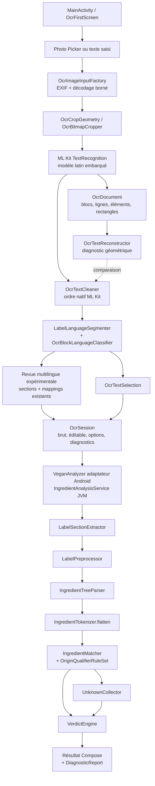

# Architecture générale

Le projet contient le module Android `:app` et le module Kotlin/JVM `:mutation-core`. Dans `app/build.gradle.kts`, `implementation(project(":mutation-core"))` relie le cœur à l’application ; la dépendance inverse est interdite. Le générateur multilingue utilisé par l’application est défini dans `:mutation-core`, tandis que l’acquisition OCR et la revue Compose se trouvent dans `:app`. Les deux modules conservent le package `com.example.isitvegan`, avec le thème Compose dans `com.example.isitvegan.ui.theme`. Il n’existe ni couche réseau métier, ni base SQL, ni service distant.

## Flux actif

L’analyse rappelle `LabelLanguageSegmenter` dans `IngredientAnalysisService`. `VeganAnalyzer` reste la façade Android et lui délègue. En OCR, le service conserve le texte éditable soumis et n’utilise pas le choix automatique issu de cette seconde segmentation pour remplacer le choix de l’utilisateur. Plusieurs listes ou segments détectés, une structure déséquilibrée ou un marqueur de langue imbriqué empêchent un verdict. Une liste unique reste éditable et analysable, avec les traces séparées. L’identifiant du bloc n’est conservé que si le texte correspond encore à son identité normalisée et que l’analyse n’est pas ambiguë.

Après segmentation OCR, `OcrProcessor` appelle la façade Android `VeganAnalyzer`, puis `IngredientAnalysisService.generateMultilingualAlignment` et le générateur pur `MultilingualIngredientAlignment` de `:mutation-core`. Celui-ci extrait et parse les sections titrées, puis réutilise les mappings et le matcher pour produire des preuves de revue, séparées du verdict. Les identifiants de concepts identiques peuvent corroborer deux occurrences ; des éléments entre deux ancres ne sont que des pistes ambiguës. Le générateur actuel ne crée pas de proposition lexicale par traduction explicite. `MultilingualAlignmentReview` affiche les preuves ; `OcrSession` vérifie le bloc, le texte et la plage avant une éventuelle acceptation explicite. L’analyse suivante utilise le texte éditable, sans appliquer silencieusement la revue.

## Responsabilités

| Zone | Composants principaux | Responsabilité |
|---|---|---|
| Entrée/UI | `MainActivity`, `OcrFirstScreen`, `UiLanguage` | état Compose, sélection de photo, édition, lancement de l’OCR et de l’analyse |
| Image | `OcrImageInputFactory`, `OcrImageSizing`, `OcrCropGeometry`, `OcrBitmapCropper` | décodage borné, EXIF, viewport, gestes et bitmap recadré |
| OCR | `OcrProcessor`, `OcrModels`, `OcrTextReconstructor`, `OcrTextCleaner` | ML Kit, conservation de la structure, reconstruction diagnostique et nettoyage |
| Langue | `LabelLexicon`, `LabelLanguageSegmenter`, `OcrBlockLanguageClassifier`, `OcrTextSelection` | marqueurs, titres, score de qualité, préférence et choix du bloc éditable |
| Sections | `LabelSectionExtractor`, `LabelPreprocessor` | composition, présence réelle, traces, notes et sections ignorées |
| Syntaxe | `IngredientTreeParser`, `FunctionalClassLexicon`, `IngredientTokenizer` | arbre d’ingrédients et aplatissement compatible avec l’analyse |
| Connaissance | `IngredientMatcher`, `OriginQualifierRuleSet`, `ingredients.json` | normalisation, alias, numéros E et qualifications d’origine |
| Décision | `UnknownCollector`, `VerdictEngine`, `AnalysisResult` | inconnus, compatibilité vegan et classification détaillée |
| Diagnostic | `DiagnosticReport`, `OcrExportReport` | rapports texte partageables à l’initiative de l’utilisateur |

`AnalysisDiagnostics.verdictExplanation` est une vue dérivée du résultat et des chemins de tokens. Elle consulte la propriété calculée `verdictWithoutUncertain`, qui peut rappeler `VerdictEngine.evaluate` en excluant uniquement les statuts `UNCERTAIN`. Il n’existe pas de second moteur divergent : `AnalysisResult.verdict` reste la référence métier et le résultat conditionnel reste une information distincte.

Les composites restent des conteneurs syntaxiques : leur token est conservé pour l’arbre et le diagnostic, mais n’est ni matché ni classé. Les feuilles et additifs descendants alimentent directement `UnknownCollector` et `VerdictEngine`. Le contexte parent → enfant ajouté au rendu des inconnus en 0.6.9.8 est une projection de présentation basée sur `parentOrder`; il n’écrit aucun statut dans le parent. La décision documentée dans `COMPOSITE_STATUS_PROPAGATION_AUDIT_0_6_9_9.md` à la racine du dépôt est de ne pas propager de statut métier enfant → `COMPOSITE`.

## État et concurrence

`MainActivity` charge les trois assets de connaissance via `VeganAnalyzer.loadDatabase` sur `Dispatchers.IO`. `AndroidIngredientKnowledgeLoader` lit les assets avec `Context`, puis `IngredientKnowledge.fromJson` les valide et les injecte dans `IngredientAnalysisService`. Aucun accès Android n’existe dans `:mutation-core`. Le bouton d’analyse reste désactivé tant que ce chargement n’a pas réussi. `OcrFirstScreen` exécute le décodage sur `Dispatchers.IO` et l’analyse CPU sur `Dispatchers.Default`. `OcrProcessor` possède un `CoroutineScope` supervisé et restitue ses callbacks sur `Dispatchers.Main`.

La session OCR est un objet immutable `OcrSession` gardé par `remember`. Elle contient le texte brut, le texte éditable, les blocs et options linguistiques, l’évaluation de revue, le diagnostic et les instantanés des analyses. L’URI de la photo n’appartient volontairement pas au modèle de session. Si le service n’est pas chargé au moment de l’extraction ou si la revue échoue, l’application signale son indisponibilité ; elle ne relance pas automatiquement la revue après chargement. Les exceptions inattendues sont aussi journalisées.

L’écran associe une génération aux demandes d’analyse, d’OCR et de préparation du recadrage. Une édition, un changement de mode, langue ou bloc, une nouvelle acquisition ou un effacement invalide les retours antérieurs ; leur arrivée tardive ne modifie plus la session courante. Une édition manuelle masque le résultat précédent, tandis que l’édition OCR garde l’indication de résultat périmé jusqu’à réanalyse, même si le texte d’origine est rétabli. Ces garde-fous ne restaurent pas la session après destruction du processus et n’annulent pas nécessairement le calcul sous-jacent.

Le message de progression est associé à l’opération qui l’a affiché : invalider une extraction ou un recadrage efface son ancien message sans effacer celui d’une opération plus récente. Chaque sélection de photo relance le chargement de l’aperçu, y compris lorsque son URI est identique à la précédente ; le chargement précédent est annulé par la composition.

## Composant hérité

`MainActivity.kt` contient encore le composable public `IsItVeganScreen`. Aucune référence du dépôt ne l’appelle : `MainActivity.onCreate` affiche `OcrFirstScreen`. Cette ancienne UI ne doit pas être utilisée comme description du chemin de production actuel, même si ses branches restent couvertes indirectement par le même moteur.

## Frontières importantes

- ML Kit produit la reconnaissance et ses rectangles ; le dépôt ne réimplémente pas un moteur OCR.
- Le parseur construit une structure sans consulter la base d’ingrédients.
- Le matcher classe les feuilles à partir de la base ; il ne corrige pas la syntaxe.
- Les traces et notes restent hors du moteur de verdict.
- L’interface ne transforme jamais une image directement en verdict : elle obtient d’abord un texte éditable.
