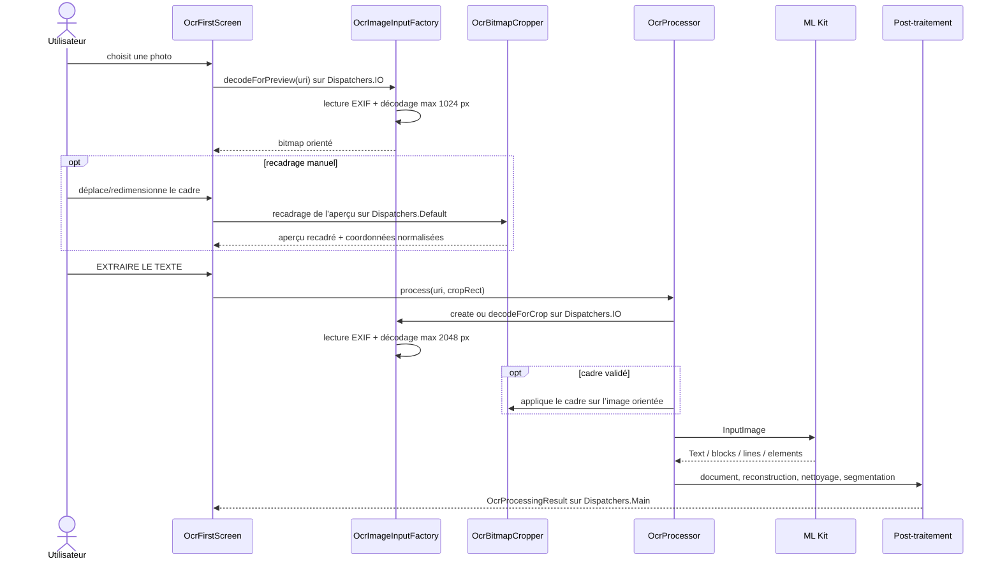

# Pipeline OCR

## Revue multilingue expérimentale

Les sections d’ingrédients titrées peuvent être comparées à partir des mappings et du matcher existants. Deux occurrences reconnues comme le même concept peuvent être présentées comme concordantes ; les conflits de statut restent distincts. Des éléments entre deux ancres communes restent des pistes ambiguës : leur position ne prouve pas qu’ils sont des traductions et aucune correction lexicale n’est générée sur cette seule base. Une traduction partielle ne prouve pas l’absence d’un ingrédient. Les blocs SV/NO détectés restent conservés sans correction lexicale, faute de mappings fiables ; leurs titres et leur sélection ne sont pas pris en charge comme pour FR/NL/EN/DE.

Les pistes ambiguës sont repliées par défaut : leur nombre et une action permettent d’en afficher ou masquer le détail. Elles restent des pistes à vérifier et ne modifient ni le texte ni le verdict.

La revue ne crée plus toutes les paires possibles dans un intervalle contenant plusieurs termes : ces associations ne sont pas établies. Les termes sans concordance établie sont accessibles dans une liste repliée, avec leur langue et leur statut reconnu ou non reconnu. Une traduction partielle ne permet pas de conclure qu’un terme manque dans l’autre liste. Cette revue conserve les occurrences des blocs et ne modifie pas le texte analysé.

La proposition `NL · probable` pour `INGREDIENTE.` reste désactivée : sa frontière n’était pas fiable. Le texte brut OCR reste disponible pour vérification et correction. L’analyse OCR ne fusionne pas plusieurs listes ou segments détectés, même si un ancien identifiant de bloc accompagne le texte édité. Elle refuse aussi une structure de parenthèses ou crochets déséquilibrée, un marqueur de langue imbriqué et un préambule non reconnu avant le titre. Dans ces cas, l’application demande de sélectionner et vérifier une seule liste et ne produit pas de verdict. Une édition d’une seule liste reste analysable ; les traces sont séparées du verdict. Les inconnus visibles restent affichés avec un verdict NON VEGAN. La reconnaissance des titres et des ingrédients demeure imparfaite ; le parcours photo complet reste à valider pour cette correction.

Les choix OCR affichent chaque section titrée confirmée dans les langues proposées par le contrôle (FR/EN/NL/DE/IT/ES/PL) comme une occurrence distincte, même lorsque plusieurs occurrences ont la même langue. Cette liste de choix ne garantit pas la couverture du lexique. Le segment initial est transmis par son `selectedSegmentId` local depuis le segmentateur jusqu’à la session et au contrôle, sans le reconstruire par identité de contenu ; si ce segment est filtré des options, aucun bouton d’occurrence n’est signalé comme sélectionné. Les numéros et identifiants de segment ne valent que pour la segmentation courante.

Le texte complet reste accessible après extraction avec zéro, une ou plusieurs options, y compris après édition d’un texte complet déjà sélectionné. Cette action restaure exactement la source complète conservée, efface les anciens résultats et invalide les requêtes en cours. Sans texte complet non vide issu d’une extraction, aucune action « texte complet » n’est proposée ; la session refuse aussi de remplacer une saisie par un texte complet indisponible ou blanc. Le passage à la saisie manuelle réinitialise la source OCR. Une sélection d’occurrence invalide le verdict et les requêtes en cours ; l’analyse utilise ensuite le texte éditable courant. Sélectionner le texte complet ne rend pas analysable un ensemble de listes : le contrôle de structure reste appliqué.

Dans le diagnostic de la session OCR, « sélectionnables » compte les options affichables ; « sélectionnés » vaut un pour le segment source placé dans l’éditeur, même s’il n’est pas proposé comme option ; « rejetés » compte les autres segments détectés. En mode texte complet, sélectionnés et rejetés valent zéro : aucun segment individuel n’est choisi ou exclu. Ces compteurs décrivent la sélection source, pas la validité du texte édité ni le nombre d’ingrédients analysés. Un segment sans titre peut être sélectionné dans l’éditeur tout en restant inanalysable. L’export conserve son identifiant local dans la segmentation OCR initiale.

Le rapport détaillé du cœur porte sur la nouvelle segmentation du **texte soumis**, pas sur les options OCR initiales. Il compte les candidats avec titre confirmé, les segments retenus individuellement et les autres segments (rejetés). Une structure OCR multiliste refusée ne présente aucun segment comme retenu ; des contenus identiques ne sont plus tous marqués retenus par égalité de hash. Les identifiants de cette nouvelle segmentation ne permettent pas de retrouver une occurrence dans la photo ou la segmentation initiale.

Des blocs textuellement identiques partagent encore un identifiant de contenu : la revue multilingue de ces répétitions demande le lot B5a. L’analyse reçoit le texte courant et, lorsqu’il correspond encore, l’identifiant de contenu source ; elle ne reçoit pas une identité durable de l’occurrence. Les tests B2 injectent le résultat d’extraction dans le véritable écran Compose et vérifient les choix, le retour au texte complet et le changement d’occurrence suivi d’analyse. Ils ne valident ni ML Kit sur une photo réelle ni la provenance géométrique.

Un export réel 0.6.13.13 est conservé comme témoin textuel dans les tests : les cinq options OCR initiales se distinguent du seul segment FR détecté dans chaque texte soumis. Le motif du choix automatique initial reste conservé après un changement de choix ; l’export le nomme désormais explicitement. Dans le rapport d’analyse, le motif du classement automatique est également distingué du contrôle de structure ultérieur. Un identifiant de contenu absent est indiqué « non établi pour le texte soumis » : il peut résulter d’une édition ou d’un refus de structure et ne prouve pas que l’utilisateur a choisi le texte complet. Le mode texte complet n’est affirmé dans le diagnostic de session que lorsque son état est connu.

Un texte titré mais refusé pour ambiguïté est présenté comme une analyse non évaluée pour structure ambiguë, distincte d’une liste absente ; l’énumération interne de disponibilité n’est pas modifiée. Le témoin corrigé reste INCERTAIN, avec inconnus visibles et traces séparées. La mention du sous-ensemble des ingrédients au statut établi ne constitue pas un résultat conditionnel : celui-ci reste masqué lorsque des inconnus sont bloquants. Le titre commercial allemand final et les erreurs OCR du témoin sont conservés pour investigation de frontières et de prétraitement séparée ; aucune transcription de référence ni validation image n’est disponible.

Ces vérifications sont prudentes et peuvent aussi refuser un texte dont la composition serait exploitable. Elles ne garantissent pas la détection de chaque titre OCR abîmé : il faut vérifier le texte et ses limites avant l’analyse. Les tests instrumentés vérifient l’indication de résultat périmé après édition et l’affichage d’un inconnu après réanalyse d’un texte donnant NON VEGAN ; ils ne valident pas le parcours complet depuis la sélection d’une photo.

Le modèle et l’interface prévoient une correction fondée sur une preuve explicite, mais le générateur OCR actuel n’en produit pas : il ne propose donc pas de remplacement lexical à partir de ces pistes. Si une telle proposition est fournie, elle ne peut être appliquée qu’au bloc OCR sélectionné, si le texte éditable correspond encore à l’option d’origine et si l’occurrence source est unique dans le bloc et l’option. L’utilisateur doit éditer puis accepter la proposition. Une édition manuelle invalide l’évaluation ; un changement de bloc conserve les preuves mais n’autorise une application que pour le bloc correspondant. Le texte complet ne permet pas d’appliquer une proposition. Le texte brut OCR reste disponible. Après modification du texte, le précédent verdict est masqué jusqu’à une nouvelle analyse du texte courant ; changer de bloc réinitialise le résultat affiché.

Si la base n’est pas encore chargée lors de l’extraction, ou si la revue multilingue échoue, l’application le signale et l’utilisateur peut relancer l’extraction. Le même message invite à relancer l’extraction dans les deux cas ; les détails d’une erreur sont réservés aux journaux. La revue ne modifie pas directement le verdict. Après un échec de réanalyse, le message d’échec reste visible et le verdict ancien reste masqué. Le passage à la saisie manuelle réinitialise le résultat affiché.

Le mode OCR est piloté par `OcrFirstScreen`. La photo reste référencée par son `Uri` pendant la composition ; les bitmaps de prévisualisation et de recadrage vivent uniquement en mémoire.

## Séquence réelle

## Acquisition et orientation

Le sélecteur utilise `ActivityResultContracts.PickVisualMedia` et limite le choix aux images. `OcrImageInputFactory` ouvre le flux via `ContentResolver` ; il ne réencode pas le fichier en JPEG et n’écrit rien dans la galerie.

Pour une image entière, `create` :

1. lit `ExifInterface.TAG_ORIENTATION` ;
2. décode un bitmap borné ;
3. transmet à `InputImage.fromBitmap` une rotation de 0, 90, 180 ou 270 degrés ;
4. applique au préalable les orientations miroir, que le simple angle ML Kit ne représente pas.

Pour le recadrage, `decodeForPreview` et `decodeForCrop` appliquent d’abord toute l’orientation EXIF au bitmap. Le rectangle normalisé correspond donc au sens visible. Le bitmap recadré est envoyé à ML Kit avec une rotation de 0 degré.

Si l’EXIF est absent, illisible ou indéfini, l’image entière conserve une rotation de 0 degré et un avertissement est ajouté. Le code n’essaie pas quatre orientations.

## Taille et mémoire

`OcrImageSizing.sampleSize` choisit un facteur de sous-échantillonnage en puissance de deux, puis `decodeScaledBitmap` réduit encore le plus grand côté si nécessaire :

- aperçu : 1024 px maximum, `RGB_565` ;
- OCR et recadrage haute définition : 2048 px maximum, `ARGB_8888`.

L’aperçu est décodé une fois dans un `LaunchedEffect(sourceUri)`, donc pas à chaque recomposition. Le recadrage haute définition n’est créé qu’au lancement de l’OCR. Les anciens aperçus et le bitmap temporaire transmis à ML Kit sont recyclés lorsque leur cycle de vie se termine.

Les erreurs d’accès, de décodage et de mémoire deviennent des messages contrôlés. Une erreur mémoire suggère un recadrage plus serré ; le texte déjà présent dans la session n’est pas remplacé par une exception.

## Recadrage

`OcrCropRect` exprime `left`, `top`, `right` et `bottom` entre 0 et 1. `OcrCropGeometry` :

- maintient le cadre dans l’image ;
- impose une largeur et une hauteur minimales de 0,12 ;
- calcule le viewport réel de l’image sous `ContentScale.Fit` ;
- teste les gestes dans l’ordre coins, bords, intérieur, extérieur ;
- donne aux coins un rayon tactile de 32 dp et aux bords 20 dp dans `OcrCropDialog`.

Les poignées visibles font 8 dp de rayon. La zone extérieure est assombrie et le coin ou bord actif est coloré. Le bouton de réinitialisation remet `cropRect` à `null`, ce qui signifie « image entière ».

## Structure conservée

`OcrProcessor.toOcrDocument` convertit la réponse ML Kit en modèles internes :

- `OcrDocument` : texte brut, orientation et blocs ;
- `OcrBlock` : numéro, ordre ML Kit, rectangle et lignes ;
- `OcrLine` : texte, rectangle, bloc, numéro, ordre ML Kit et éléments ;
- `OcrElement` : texte, rectangle, bloc, ligne et ordre dans la ligne.

Le texte brut de `Text.text` est copié tel quel dans `OcrDocument.rawText`, puis dans `OcrProcessingResult.rawText`. Il ne passe pas par le nettoyeur.

## Reconstruction et ordre natif

`OcrTextReconstructor` peut :

- revenir à l’ordre ML Kit si des coordonnées manquent ;
- regrouper les zones qui se chevauchent verticalement et les trier de gauche à droite ;
- détecter une coupure de colonnes seulement lorsqu’un espace horizontal dépasse 1,5 fois la hauteur moyenne et que les colonnes coexistent verticalement ;
- séparer par une ligne vide deux blocs dont l’écart vertical dépasse 1,5 fois la hauteur moyenne.

Depuis 0.6.5, et toujours en 0.6.8, cette reconstruction n’est **pas** la source du texte analysé. `OcrProcessor` nettoie `recognized.text`, compare ce résultat à la reconstruction géométrique, puis conserve l’ordre natif ML Kit. Une divergence ajoute l’avertissement « ordre natif ML Kit conservé ; reconstruction géométrique ignorée ».

## Nettoyage déterministe

`OcrTextCleaner.clean` compile ses expressions régulières à l’appel pour qu’une incompatibilité du moteur Android reste interceptable par `OcrProcessor`. Il effectue seulement des transformations bornées :

- fins de ligne CRLF vers LF ;
- réunion d’une coupure avec trait d’union explicite ; le trait est conservé entre deux séquences de majuscules Unicode et supprimé avant une suite en minuscules ;
- correction de `ingrédlents` uniquement lorsqu’il ressemble à un titre français délimité ;
- espaces multiples, ponctuation, deux-points et parenthèses ;
- espace manquant après une virgule ;
- normalisation prudente des titres « ingrédients » et « peut contenir ».

Les tests garantissent notamment la conservation de `11,9 %`, `E471`, `PETIT-LAIT`, des parenthèses imbriquées, des astérisques et des mots inconnus. Il n’existe ni dictionnaire autocorrectif, ni traduction, ni correction probabiliste des nombres.

`cleanSelectedBlock` peut tronquer un bloc sélectionné à partir d’un début de ligne manifestement parasite : « open here », « ouvrir ici », importateur/importer/imported by ou certification/certified.

## Session et échecs

`OcrSession` conserve séparément :

- `rawOcrText`, sortie originale ML Kit ;
- `editableText`, bloc sélectionné et nettoyé ;
- `fullOcrText`, texte nettoyé complet ;
- les options linguistiques et le choix courant ;
- le diagnostic OCR ;
- les instantanés exacts des analyses déjà lancées.

Une nouvelle photo, un nouveau cadre ou une sélection linguistique invalide les analyses précédentes. Une modification manuelle du texte invalide l’affichage courant, mais les anciens instantanés restent dans l’export jusqu’à la remise à zéro de la session.

Si le post-traitement lance une `RuntimeException`, `OcrProcessor` rend le texte brut éditable, marque `usedRawFallback` et ajoute un avertissement. Les échecs ML Kit produisent un message de saisie manuelle. `close` annule le scope et ferme le recognizer.

## Limites constatables

Le texte OCR n’est pas une preuve autonome : il doit être relu et corrigé dans le champ éditable avant l’analyse. Une photo floue, tronquée, trop serrée, tournée, très dense ou mal éclairée peut produire une composition incomplète ou des inconnus. Lorsque la liste ne tient pas dans le cadre ou reste difficile à lire, reprendre une photo plus nette avec un cadrage plus large est la meilleure action manuelle.

Une suggestion automatique de reprendre la photo plus large n’est pas livrée. La revue expérimentale ne fusionne pas plusieurs blocs linguistiques en une composition ; ses pistes ne remplacent pas la vérification humaine.

- Le recognizer configuré est uniquement `TextRecognizerOptions.DEFAULT_OPTIONS`, donc le script latin.
- Une image sans EXIF exploitable n’est pas redressée par analyse visuelle.
- Il n’existe pas de correction de perspective.
- La reconstruction géométrique n’alimente pas actuellement le texte analysé.
- Le vocabulaire de reclassification linguistique est volontairement court et orienté ingrédients courants.
- Un recadrage trop serré ou la limite de 2048 px peut supprimer des détails fins ; l’utilisateur garde l’aperçu et le texte brut pour vérifier.

Les titres d’ingrédients FR, NL, DE, EN, IT et ES exigent un séparateur. Les formes NL OCR `ngrediënten`, `Inoredienten` et `Ingrediênten` sont acceptées seulement à cette frontière ; une mention biologique n’est jamais une composition. Les corrections déterministes sont appliquées après sélection de la section et figurent dans le diagnostic. La reconstruction complète des colonnes reste une limite connue : les blocs géométriques ML Kit et les segments linguistiques restent distincts.
