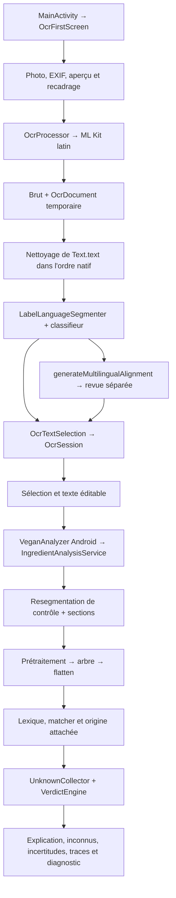

# Préparation v0.7 — architecture et plan multilingue

Date : 30 octobre 2026. Analyse locale, sans modification applicative et sans exécution de test, build, benchmark, installation, commit ou push. Seul ce rapport est ajouté. Les noms de nouveaux modèles et fichiers ci-dessous sont des propositions, pas des API existantes.

## 1. Référence, méthode et preuves

Branche `master`, HEAD `6c34424a7e8e07116c7a0516f0425724b488ffc9` (`Improve multilingual OCR review of unmatched ingredients`). Version déclarée : `0.6.13.11`, code 63. Au départ, `git status --short --branch --untracked-files=all` affiche seulement `master...origin/master` ; les diffs indexé/non indexé et `git ls-files --others --exclude-standard` sont vides. Cela décrit le dépôt local, sans vérification réseau de la branche distante. Aucun fichier ignoré n'est assimilé à un fichier non suivi. Aucun changement existant n'a été supprimé.

Instructions consultées : `AGENTS.md`, skills locaux `android-validation` et `benchmark`, avec `benchmark/references/benchmark-workflow.md`. Ils cadrent les niveaux de preuve et les validations proposées. Aucun import de connaissance, campagne PIT ou profilage n'est nécessaire à cette analyse.

Sources locales principales, relatives à ce rapport :

- [Inventaire du cœur et de son utilisation](../reviews/REVIEW_0_7_CORE_APPLICATION_INVENTORY_20261029.md) : point de départ réutilisé ; pas de nouvel audit exhaustif du cœur.
- [Rejeu réel 5087](../reviews/REVIEW_0_7_OCR_MULTILINGUAL_EMULATOR_5087_20261029.md) : observations et limites du parcours photo.
- [Prototype initial](MULTILINGUAL_ALIGNMENT_PROTOTYPE_IMPLEMENTATION_20261029.md) : historique, dont les propositions entre ancres ne décrivent plus HEAD.
- [Architecture préliminaire](PRE_0_7_ARCHITECTURE_ANALYSIS.md) et [préparation historique](PRE_0_7_FINAL_READINESS_REPORT.md) : intentions et état de septembre ; leurs versions, effectifs de connaissance et hypothèses de performance ne sont pas des mesures actuelles.
- [Intégration de l'optimisation](../benchmark/INTEGRATION_NORMALIZATION_OPTIMIZATION_20261010.md), [A/B Nokia final](../benchmark/COMPARISON_NORMALIZATION_AB_AND_PROFILE_20261010.md) et [protocole réel multilingue](../benchmark/PROTOCOL_REAL_LABEL_MULTILINGUAL_NOKIA.md). Le rapport A/B final dépasse les comptes rendus intermédiaires limités au passage A.
- Documentation maintenue : [architecture](../../../docs/architecture.md), [OCR](../../../docs/ocr.md), [langues](../../../docs/langues.md), [tests](../../../docs/tests.md), [changelog](../../../docs/changelog.md).

Vérifications ciblées à HEAD : dépendances Gradle, entrée `MainActivity`, traitement `OcrProcessor`, modèles OCR, sélection/session/écran/revue, segmentation, génération d'alignement, sélection OCR dans `IngredientAnalysisService`, moteur et formatteur. Les chemins cités ensuite sont relatifs à la racine du dépôt ; package commun `com/example/isitvegan`. Recherche par `rg`, lectures d'extraits, `git log` et `git show` du dernier commit. Une recherche d'un fichier autonome `OcrFirstScreenResult.kt` a échoué : ne pas en déduire l'absence du symbole utilisé par l'écran.

### Ce qui est démontré, et à quel niveau

| Élément | Preuve disponible | Limite |
|---|---|---|
| Cœur utilisé par l'app | `app/build.gradle.kts` dépend de `:mutation-core`, entrée et appels inspectés | Ce passage n'a construit ni inspecté d'APK |
| Revue multilingue | Appels OCR → service → générateur → session → Compose présents | Accessibilité statique ; toutes les branches ne sont pas validées au runtime |
| Prototype initial | Documentation : 47 tests ciblés, assemblages app/androidTest réussis ; callback d'acceptation Compose testé sur `Pixel_10_Pro` après correction du montage | Proposition synthétique ; pas une correction produite depuis une photo |
| 5087 | Rapport : import galerie, ML Kit, DE sélectionné, analyse, édition, résultat périmé, réanalyse sur `emulator-5554`, Android 17/API 37, `sdk_gphone16k_x86_64`, app déclarée 0.6.13.8 | Un rejeu ; ni Nokia, ni validation complète des autres blocs, ni état runtime de HEAD |
| Sécurité des éditions | Changelog : trois tests instrumentés sur `Pixel_8`, `emulator-5554` ; texte édité, péremption, inconnus avec NON VEGAN, plusieurs listes refusées | Texte injecté ; ne valide pas l'acquisition photo complète |
| Dernier changement HEAD | Tests source pour termes sans concordance et suppression des paires multiples présents | Aucun compte rendu d'exécution spécifique à HEAD établi ici ; existence ≠ réussite |
| Performance moteur | A/B historique Nokia G42 5G, Android 15 : analyse propre ~10,65/10,58 s en A et ~1,07/1,08 s en B ; assertions réussies | Chaînes déterministes, sans ML Kit ; pas la latence v0.7 multilingue actuelle |

Le rapport d'intégration signale deux échecs historiques de suite complète sur des effectifs attendus (`KnowledgeIndexTest`, `Phase4MatcherProfileTest`). Ils ne sont ni reproduits ni déclarés résolus ici. Le profil CPU après optimisation n'a pas été réalisé ; le prochain hotspot reste à mesurer. Les regex réutilisées et normalisations sorties des boucles appartiennent au chemin actif, sans démontrer un gain supplémentaire à HEAD.

## 2. Parcours actuel de bout en bout

### Acquisition et conservation

`MainActivity.onCreate` ouvre `OcrFirstScreen`, chargeant les trois assets locaux par `AndroidIngredientKnowledgeLoader` puis `IngredientKnowledge`. L'ancien `IsItVeganScreen` n'est pas l'entrée actuelle. Aucune décision métier ne nécessite de service distant.

Dans `app/src/main/java/...`, `OcrImageInputFactory` gère EXIF, images miroir et décodage borné : aperçu 1024 px, OCR 2048 px. Le recadrage est manuel et normalisé dans l'image orientée. Le recognizer est ML Kit latin. `OcrProcessor` transforme ses blocs/lignes/éléments et rectangles en `OcrDocument`, mais ce document n'est pas inclus dans `OcrProcessingResult` ni conservé par `OcrSession`. Il sert à la reconstruction et aux diagnostics pendant le traitement. La géométrie n'est donc pas exploitable ultérieurement par la revue actuelle.

`recognized.text` est conservé tel quel dans `rawText`, puis `rawOcrText`. Le texte éditable complet est nettoyé dans l'ordre natif ML Kit ; la reconstruction géométrique reste un comparateur diagnostique. Les transformations du nettoyeur ne fournissent pas de table de correspondance entre caractères bruts et nettoyés. `LanguageBlock.rawText` désigne une portion du texte segmenté après nettoyage, pas nécessairement une sous-chaîne exacte de `Text.text`.

La session conserve brut, texte complet nettoyé, options, blocs, diagnostic, revue et instantanés d'analyse. URI et bitmaps restent côté écran, en mémoire ; la session est gardée par `remember`, sans contrat de restauration durable démontré. L'export contient les instantanés ; une nouvelle session les remet à zéro.

### Segmentation, choix et édition

`LabelLanguageSegmenter` et `OcrBlockLanguageClassifier` combinent titres, marqueurs et indices lexicaux. `LanguageBlock` porte langue, bornes, texte, marqueur, score, signaux, indicateur de troncature, `headingConfidence`, `id` et `segmentId`. `stableBlockId` dérive d'un texte normalisé puis d'un hash 32 bits : deux copies identiques peuvent avoir le même identifiant ; ce n'est pas une identité suffisante d'occurrence physique.

`OcrTextSelection` ne propose que des blocs titrés confirmés et des langues sélectionnables. FR/NL/EN/DE sont le socle à maintenir ; IT/ES/PL figurent aussi au sélecteur, sans que cela prouve une couverture lexicale équivalente. Les options sont regroupées par langue et une seule retenue : deux compositions dans la même langue ne sont pas deux choix indépendants. La langue d'interface influence la préférence ; l'utilisateur peut choisir un autre bloc ou « Texte complet ».

La piste `INGREDIENTE.` n'est pas branchée aux marqueurs : le helper expérimental existe mais la sélection `NL · probable` est désactivée. Ni vocabulaire, ni majuscules, ni titre voisin ne prouvent une frontière sûre. `cleanSelectedBlock` peut couper certains parasites explicites ; une future provenance doit aussi rendre ces retraits inspectables.

L'édition efface l'évaluation multilingue, masque le diagnostic courant et laisse les anciens instantanés permettre l'indication de résultat périmé. Changer de bloc réinitialise les analyses affichées. L'acceptation prévue est très restrictive : bloc et langue sélectionnés, texte encore égal à l'option d'origine, source unique dans bloc et option, preuve présente. Elle remplace du texte puis demande une nouvelle analyse. L'application actuelle vérifie le texte et le mode au retour du calcul asynchrone ; un futur contrat doit aussi vérifier révision de session et portée, notamment après un aller-retour vers un texte identique.

### Comparaison multilingue

`IngredientAnalysisService.generateMultilingualAlignment` appelle `MultilingualIngredientAlignment.generate` dans `mutation-core/src/main/kotlin/...`. Le générateur exige au moins deux langues dans des blocs titrés, extrait les ingrédients, parse et aplatit, réutilise lexique/matcher/règles d'origine. `IngredientOccurrence` conserve texte, ordre, parent/profondeur, concept/statut éventuels ; pas de plage source exacte. La récupération textuelle des occurrences recherche des chaînes dans le texte extrait : elle ne remplace pas une provenance structurée.

Les identités canoniques communes uniques de chaque côté produisent une corroboration, même si l'ordre varie. Les répétitions empêchent cette unicité. Des ancres monotones peuvent encadrer une seule occurrence de chaque côté et produire une piste ambiguë ; si l'ordre des ancres croise, cette recherche est abandonnée. HEAD ne produit plus le produit cartésien des intervalles multiples. Les occurrences restent conservées et l'UI expose les termes sans concordance, reconnus ou inconnus, dans un détail replié ; les ambiguïtés sont aussi repliées.

L'évaluateur connaît conflits et `EXPLICIT_TRANSLATION`, qui peut créer `CORRECTION_PROPOSAL`. Le générateur OCR ne crée que `CANONICAL_ID` et `AMBIGUOUS` : le remplacement lexical n'est pas actuellement atteignable depuis une proposition générée sur photo. Les statuts sont ceux du matching d'occurrences, pas un vote entre langues. SV/NO conservés/détectés ne signifient pas des titres sélectionnables et mappings fiables.

### Texte soumis, parsing, matching et verdict

L'écran soumet le texte éditable courant à la façade Android `VeganAnalyzer`, puis à `IngredientAnalysisService.analyzeWithDiagnostics`. Le service resegmente pour contrôler, sans substituer automatiquement un autre bloc au texte choisi. Plusieurs titres/listes/segments, parenthèses/crochets déséquilibrés, marqueur imbriqué ou préambule non reconnu avant titre empêchent le verdict OCR. Ces gardes sont conservatrices mais ne détectent pas tous les titres abîmés.

`LabelSectionExtractor` distingue ingrédients, présence déclarée et traces ; `LabelPreprocessor` prépare le texte ; `IngredientTreeParser` construit l'arbre ; `IngredientTokenizer.flatten` conserve ordre et parenté. Les composites sont des conteneurs ; les descendants considérés alimentent la décision. Lexique, `IngredientMatcher`, normalisation OCR bornée et `OriginQualifierRuleSet` résolvent les feuilles ; les qualifications restent locales. `UnknownCollector` maintient les inconnus. Aucun index expérimental n'est à brancher pour cette v0.7 : l'inventaire établit que `KnowledgeIndex`/`IndexedCandidateProvider` ne sont pas le moteur actif.

Attention aux noms : `AnalysisVerdict` utilise notamment `NON_VEGETARIAN` et `VEGETARIAN`, tandis que `VeganAssessment` utilise `NOT_VEGAN`. `VerdictEngine.evaluate` donne priorité au non-végétarien, puis à l'incertain connu, puis aux inconnus/absence de reconnu, avant végétarien/vegan ; l'évaluation de compatibilité vegan bloque aussi lait/œuf/etc. Le formatteur expose ces vues et le résultat conditionnel. Ce plan conserve ce contrat : ne pas réécrire les enums ni les priorités pour correspondre au vocabulaire produit.

Inconnus et incertitudes restent visibles, y compris avec NON VEGAN. `contient : lait` est une présence réelle ; « peut contenir du lait » est une trace séparée. La revue ne participe pas au verdict actuel. Une analyse favorable du seul bloc choisi n'établit pas aujourd'hui une composition consolidée de toute la photo.

## 3. Parcours v0.7 visé et statut des décisions

**Acté par la demande et les invariants** : offline, déterminisme, accès aux sources, édition avant analyse, visibilité des inconnus/incertitudes, traces exclues, texte courant, acceptation explicite, absence de suppression rassurante par traduction partielle. Position et majorité ne sont jamais des preuves d'identité. FR/NL/EN/DE restent compatibles.

**Proposition de parcours**, à valider comme produit :

1. Après extraction, afficher les blocs disponibles, leur couverture et leurs réserves, ainsi que le brut et l'aperçu accessibles. La préférence d'affichage FR ne force pas l'utilisation d'une composition FR tronquée.
2. Choisir un bloc de référence exploitable, puis une langue d'affichage distincte. Le nom localisé d'un concept reconnu est une présentation ; les mots d'origine restent consultables. Sans mapping fiable, montrer le terme source et sa langue, sans traduction inventée.
3. Présenter une composition de travail avec correspondances confirmées, termes sans concordance et candidats incertains. « Confirmé » signifie identité reconnue, pas exactitude certifiée de la photo ni statut vegan confirmé. Conserver les différences de quantité, origine, parent et section.
4. L'utilisateur ouvre un élément, compare ses sources et l'image, corrige ou accepte une opération précise. Les propositions ne modifient ni texte ni statut. L'acceptation modifie le brouillon, journalise la provenance, invalide le résultat et nécessite « Analyser ».
5. Avant une conclusion sur la composition reconstruite, résoudre les frontières et les éléments susceptibles d'en faire partie. Une liste analysable seule reste accessible avec sa portée explicite ; elle ne remplace pas une conclusion globale bloquée.

### Exemples de comportement attendu

| Situation | Affichage et action | Conséquence |
|---|---|---|
| FR `sucre, farine de blé, sel` / NL `suiker, tarwebloem, zout` | Concordances si mappings existants univoques ; choix d'affichage FR ; sources NL accessibles | Même identité ne prouve pas à elle seule que toute la liste a été lue |
| DE `Pflanzliches 0l (Palm)` / EN `Vegetable oil (Palm)` | Source erronée conservée ; correction candidate seulement si règle OCR/mapping explicite valable et qualification compatible | Pas de transfert automatique du statut d'une huile générique ou d'une autre occurrence |
| EN `sugar, gelat1n, citric acid` / NL `suiker, tarwebloem, citroenzuur` | Intervalle ambigu, mots visibles ; jamais remplacer `gelat1n` par farine à cause des ancres | Inconnu conservé ; aucune confirmation vegan fondée sur cet alignement |
| FR illisible/tronqué ; EN exploitable | Utiliser EN comme référence, noms FR uniquement pour concepts connus, avertir que FR est partiel | Repli utile, sans inventer les ingrédients FR manquants |
| `milk` lisible uniquement en EN, absent du bloc FR | Montrer présence dans EN, absence de concordance en FR ; vérifier même produit et vraie composition | Si présence animale confirmée dans le périmètre retenu, bloque vegan ; sinon réserve explicite, jamais ignorer |
| `E471` / `E471 d'origine végétale` | Identité du code reconnue, qualifications différentes visibles | L'origine attachée d'une occurrence ne qualifie pas toutes les autres |
| Une liste se termine après `sucre,` ou une parenthèse ouverte | Montrer la limite et demander vérification/reprise | La traduction plus courte ne prouve pas l'absence des termes suivants |
| Une seule langue | Sélection, édition et analyse habituelles ; annoncer comparaison indisponible | Aucune obligation de fournir une deuxième langue pour utiliser l'app |
| Traces NL de lait, composition FR sans lait | Section traces séparée et sourcée | Pas de lait ajouté aux ingrédients ; présence explicite non assimilée à une trace |

« Manquant » doit rester réservé à une omission établie par vérification ; par défaut écrire « présent dans cette source, sans correspondance établie dans l'autre ». Un terme illisible est une lacune de lecture, un inconnu est un texte lisible non reconnu, une origine incertaine est une connaissance existante : trois problèmes différents.

**Photo plus large proposée**, jamais lancée automatiquement : bords de bloc coupés, début/fin absent, continuité hors cadre, différence non résolue suggérant une partie non capturée. Donner la raison et garder le brouillon. Sur texte minuscule/flou, un cadrage plus large peut aggraver la lecture à 2048 px : proposer plutôt une photo plus nette ou plusieurs prises, sans promettre l'assemblage multi-photo en v0.7. Un simple inconnu lexical n'est pas une preuve de mauvais cadrage.

## 4. Architecture proposée et règles de sûreté

### 4.1 Modèle de provenance et frontières de modules

Conserver `:app → :mutation-core`. App : URI, bitmaps, ML Kit, conversion géométrique, état/UI. Cœur : modèles indépendants d'Android, segmentation candidate, occurrences, preuves, opérations de revue et admissibilité de la composition. Pas de nouvelle base, module, index de recherche ou service réseau nécessaire.

| Modèle proposé | Données et règles |
|---|---|
| `SourceDocument` | Identifiant de capture, brut immuable, version de traitement ; unités de lecture et géométrie primitive facultative. App garde URI/cadre/EXIF et la transformation vers les coordonnées de l'image orientée |
| `SourceSpan` | Document + plage UTF-16 demi-ouverte `[start,end)` dans le brut ; références lignes/éléments si disponibles. Un texte reconstruit peut référencer plusieurs plages ; ne pas inventer une plage continue |
| `TextProjection` | Texte nettoyé et opérations de transformation vers les plages brutes ; segments non mappables explicitement signalés. Ne jamais assimiler offset nettoyé et offset brut |
| `SourceBlock` | Identité de capture + instance de bloc, plages, texte brut/projection, langue candidate et indices, ordre natif, géométrie facultative, titre observé, frontières candidates, couverture et réserves |
| `SourceOccurrence` | ID distinct du concept, bloc/révision, plages ou provenance non résolue, texte source, texte parsé, chemin parent/enfants, ordre, classe/quantité/qualificatifs, section ingrédient/présence/trace/inconnue ; résultat de reconnaissance séparé |
| `AlignmentEvidence` | Occurrences concernées, type et origine de preuve, mapping/règle/version, concepts candidats, réserves de structure/qualification, relation identité ou candidat ; pas un statut partagé |
| `ReviewOperation` | Cible et révision attendue, avant/après, acceptation/refus, références aux preuves et sources. Accepter une frontière n'est pas accepter une correction lexicale |
| `VerifiedComposition` | Référence, occurrences retenues et ordre d'analyse, choix de l'utilisateur, lacunes restantes, révision, provenance de chaque fragment et portée. « Vérifié » signifie revue utilisateur, sans garantie de vérité OCR |

Étendre ou adapter `IngredientOccurrence` plutôt que dupliquer durablement deux modèles concurrents. Les premières tranches peuvent rester additives. `LanguageBlock.id` reste compatible avec les consommateurs existants, mais une nouvelle identité d'instance distingue les copies identiques et les langues répétées. Une identité de contenu n'autorise pas une application sur une autre capture. Le modèle `RuntimeOccurrence` expérimental n'est pas automatiquement adapté : vérifier son contrat avant réutilisation, sans migration du matcher.

Les lacunes non parsables restent des fragments visibles avec provenance ; elles ne doivent pas disparaître parce qu'aucun token ne les représente. Les composites gardent leur structure sans recevoir le statut de leurs enfants. Le coût de conservation doit être borné : partager les chaînes sources, référencer les plages, ne pas multiplier les copies d'images.

### 4.2 Récupération d'un titre abîmé, sans couper le voisin

1. Conserver d'abord une couverture intégrale du brut : chaque plage appartient à un bloc confirmé, un résidu ou une zone explicitement non classée. Les espaces et titres restent traçables ; toute suppression de projection est expliquée.
2. Détecter un titre candidat à partir de plusieurs indices : forme du titre, langue du contenu, géométrie/lignes, séparateurs, continuité de phrase et structure. Ce sont des indices, pas une preuve automatique.
3. Produire une vue candidate superposée aux plages existantes. Ne pas déplacer ni tronquer le bloc précédent. Une zone de frontière disputée peut appartenir à plusieurs hypothèses, avec ce chevauchement explicite.
4. Montrer la fin du voisin et le début candidat ensemble. L'utilisateur confirme les limites ou les ajuste ; les fragments exclus restent disponibles et leur rôle doit être justifié avant consolidation.
5. Promouvoir uniquement l'hypothèse vérifiée dans le brouillon. Tant que la frontière peut retirer `MILCH`, une autre feuille ou un sous-ingrédient au voisin, bloquer une conclusion globale favorable.

Pour 5087, garder `INGREDIENTE.` comme preuve observée, sans règle spéciale au produit. Aucun simple rétablissement de `probableDutchHeadings` dans `findMarkers` n'est acceptable. Tester aussi les faux titres commerciaux et des mots en majuscules qui sont des ingrédients. La couverture brute est une condition nécessaire ; elle ne suffit pas si l'analyse sélectionne ensuite une sous-liste qui évite les résidus.

### 4.3 Alignement : un graphe d'occurrences explicable

Séparer quatre opérations : extraire les occurrences de chaque source ; reconnaître indépendamment ; proposer des liens ; évaluer leur admissibilité. Garder les liens et les décisions de revue hors de `IngredientMatcher` et `VerdictEngine`.

- Même identifiant canonique issu d'une résolution univoque : identité candidate forte, sous réserve de section, parent, quantité et qualification. Un code E identique identifie le code, pas son origine.
- Réordonnancement : accepter les identités justifiées sans imposer la monotonie ; ne pas reconstruire automatiquement un ordre commun « majoritaire ». Garder l'ordre du bloc de référence.
- Répétitions : conserver toutes les occurrences ; l'identité de concept ne décide pas quelle répétition correspond à laquelle. Utiliser parenté/qualificatifs et contexte comme contraintes ; garder plusieurs candidats si non univoque.
- Parenthèses : comparer dans le contexte du composite. Un sel dans une garniture et un sel au niveau principal ne deviennent pas une occurrence unique. Classes fonctionnelles et feuilles ne sont pas interchangeables.
- Listes partielles : absence de lien ≠ absence d'ingrédient. Ne jamais compléter, supprimer ou dédupliquer par longueur de liste, majorité de langues ou seul numéro de position.
- Deux termes entre ancres : contexte de recherche seulement. Proximité graphique, distance d'édition et score linguistique peuvent classer des candidats, jamais appliquer une correction.
- Conflits de concepts/statuts/quantités : garder les deux lectures. Une contradiction d'origine ou de section impose une revue spécifique, même si le concept canonique concorde.

Ne pas faire de fermeture transitive aveugle : A↔B et B↔C ne prouvent pas que toutes les occurrences de A/B/C sont identiques. Un regroupement exige la compatibilité de toutes ses contraintes. Les paires de blocs doivent aussi appartenir au même produit/à la même composition ; une photo de deux produits ou plusieurs variantes est un contre-exemple obligatoire.

### 4.4 Quelles preuves pour une correction proposée ?

**Admissibles à étudier** : alias/traduction explicite déjà revu vers un concept disponible, règle OCR bornée à la bonne langue et documentée, désignation/code E cohérents, ou transcription directe confirmée sur la photo par l'utilisateur. Conserver l'identifiant du mapping, sa relation et son contexte ; un alias large ou une résolution avec plusieurs concepts n'est pas une identité exacte.

Exiger cible précise, langue applicable, contexte compatible, absence de conflit non résolu et provenance consultable. Le cas `0l → Öl` doit être couvert par une règle explicite avant d'être offert automatiquement ; la ressemblance seule n'autorise pas la proposition. Une traduction correcte d'un autre ingrédient n'est pas la preuve que l'inconnu est ce même ingrédient.

**Insuffisants** : deux ancres, même position, deux langues contre une, statut commun, texte « presque pareil », quantité proche, nom plausible ou seule acceptation d'un candidat non justifié. L'utilisateur peut toujours saisir une correction manuelle, enregistrée comme telle ; l'acceptation ne transforme pas une hypothèse en preuve automatique.

La carte doit montrer avant/après, sources et raison. Refuser laisse tout inchangé ; accepter crée une opération et une nouvelle révision, sans écrire de `canonicalId`/statut dans l'occurrence source. Les déplacements d'offset après édition nécessitent un recalcul ; une preuve ancienne ne peut être réappliquée par recherche du premier texte identique.

### 4.5 Passage au moteur existant et complétude

Recommandation : commencer par un bloc de référence unique corrigé, accompagné d'un registre des différences non résolues. Une consolidation multi-source vient après ce contrat. Ne pas concaténer les traductions pour les faire passer à l'analyse OCR actuelle : elle refuse justement plusieurs listes.

Prévoir un adaptateur pur `ReviewedCompositionAdapter` : entrée = révision relue, texte de référence courant et opérations acceptées ; sortie = une seule composition syntaxiquement valide + table de provenance + réserves bloquantes. Repasser par sections/parser/matcher/règles/verdict existants, sans court-circuit par les statuts de la revue. Le texte choisi reste la source d'analyse ; aucun ancien bloc ne le remplace.

Les ajouts depuis une autre source doivent être explicitement retenus, placés dans la bonne structure et transcrits dans une forme reconnue par le moteur. Si la forme cible n'est pas connue dans la langue d'analyse, garder le terme source et l'inconnu, ou demander une transcription vérifiée ; ne pas élargir implicitement le matching à toutes les langues. Éviter un nouvel `InputMode` contournant les protections OCR. Un éventuel contrat d'entrée structurée sera une évolution séparée si le texte unique devient insuffisant.

Ajouter une évaluation de **portée et complétude** distincte du verdict d'ingrédients : `CLEAR`, `NEEDS_REVIEW`, `INSUFFICIENT_SOURCE` sont des noms proposés. Une frontière contestée, un résidu potentiellement ingrédient, une lecture animale dans une autre traduction ou une différence non résolue ne peut être masquée par un texte de référence vegan. Afficher « conclusion sur la composition non disponible » avec la raison ; le résultat détaillé du bloc reste étiqueté comme tel. Ne pas convertir artificiellement une lacune en token inconnu factice, ni changer le moteur pour obtenir le bon libellé.

Ce contrôle de portée demande une décision produit explicite (D2 ci-dessous), car il ajoute une condition à l'affichage global, sans modifier `VerdictEngine`. Une analyse locale déjà NON VEGAN peut rester visible pendant la revue : aucune réserve ne rend un animal vegan. Une source animale candidate non vérifiée donne une alerte et empêche une conclusion favorable ; une présence animale confirmée dans la composition retenue doit atteindre le moteur et bloquer vegan. Un rejet utilisateur exige une raison de portée (autre produit, trace, faux OCR vérifié), pas un simple bouton pour cacher l'alerte.

Inconnus lisibles : conserver et transmettre ; connus d'origine variable : conserver `UNCERTAIN` sauf règle attachée déjà autorisée. Garder toutes les qualifications contradictoires jusqu'à résolution. Traces séparées, y compris dans les différences ; présence explicite dans les ingrédients. La langue d'affichage ne doit changer aucun de ces résultats.

Le rendu et l'export doivent identifier source/révision, portée et réserves, y compris pour le résultat conditionnel : un sous-résultat vegan ne doit pas prendre la place de la conclusion bloquée. Au retour d'une coroutine, publier uniquement si capture, révision, portée et mode correspondent encore, même si le texte est redevenu identique.

### 4.6 Coût sur appareil modeste

Le générateur actuel construit un matcher par génération, parse chaque bloc éligible et parcourt les paires de blocs. Avec B blocs et N occurrences par bloc, les comparaisons de blocs sont quadratiques en B ; ne pas y ajouter systématiquement toutes les paires N×N d'occurrences. Indexer localement les occurrences par concept reconnu, conserver les candidats ambigus par groupes et plafonner le travail interactif avec un avertissement explicite. Une limite ne doit pas faire disparaître un élément du registre de couverture.

Partager connaissance immuable et résultats de parsing par révision si les mesures le justifient ; vérifier la sûreté de concurrence avant de partager un matcher mutable. Calcul CPU sur `Dispatchers.Default`, annulation ou rejet de résultats obsolètes, listes Compose paresseuses si le volume le demande. Garder les rectangles et plages est léger comparé aux bitmaps, mais ce coût reste à mesurer ; pas de promesse mémoire chiffrée.

Mesurer séparément décodage/ML Kit, projections et segmentation, parsing/reconnaissance de chaque bloc, génération des liens, recomposition/accès au bouton, analyse finale et mémoire du processus. Les ~1,07 s historiques sans OCR ne sont pas un budget démontré pour cette revue. La réduction A/B de normalisation reste valable pour son harness ; elle ne mesure ni la revue ni l'UI.

## 5. Évaluation proposée

### Corpus déterministe et contre-exemples

Fixtures texte et géométrie synthétiques en JVM, étiquetées avec origine et résultat attendu. Pour chaque cas : couverture du brut, occurrences conservées, liens/propositions permis ou interdits, texte avant/après, inconnus/incertains/traces et portée du verdict. Tester déterminisme, idempotence de lecture et absence de mutation des sources.

| Famille | Cas minimum et assertion discriminante |
|---|---|
| Frontières | `MILCH` avant `INGREDIENTE.`, faux titre commercial, titre dans parenthèse, liste sur une ligne, titre voisin anglais ; aucun ingrédient perdu ou déplacé silencieusement |
| Provenance | Nettoyage avec césure, accents et caractères UTF-16, lignes multiples, blocs identiques répétés, plage non mappable ; retour exact au brut ou réserve explicite |
| Correspondances | FR/NL/EN/DE, mêmes concepts en ordre différent, répétitions dans deux composites, parents différents ; conserver les occurrences distinctes |
| Listes partielles | Préfixe/suffixe tronqués, occurrence unique dans une langue, deux produits ; aucune absence inférée ni fusion entre produits |
| Faux alignements | `gelat1n`/`tarwebloem` entre sucre et acide, plusieurs inconnus entre ancres, A↔B↔C contradictoires ; aucune correction sur position/majorité |
| Origine/statut | Animal seulement dans une source, lait/œuf, E471 qualifié/non qualifié, allergène en présence explicite ou en trace ; pas de transfert d'origine ni exclusion de présence réelle |
| Résultat | Tous connus vegan sur composition relue ; inconnu seul ; incertain connu ; animal + inconnu ; animal + incertain ; manque de couverture + sous-résultat favorable ; vérifier résultat et visibilité séparément |

### Étiquettes réelles et 5087

Réutiliser `app/src/androidTest/assets/benchmark/real-labels/5087.jpg` comme étiquette réelle existante. Référence historique : SHA-256 `0035C77089F01B0D1D20553B8BE3848AE6ECB05A6EA4E59025010BDF907083A9` ; à revérifier avant un futur rejeu. Les extraits bruts du rapport ne forment pas une sortie exhaustive. La continuation NL reconstruite dans une fixture doit rester marquée synthétique, distincte d'une transcription réellement capturée.

Séparer trois vérités : image imprimée relue humainement, sortie ML Kit capturée, résultat métier attendu pour cette sortie. Conserver doutes, troncatures et versions d'OCR ; ne pas appeler « vérité terrain » un texte corrigé supposé complet. Ajouter d'autres étiquettes autorisées FR/NL/EN/DE, une seule langue, plusieurs produits, reflets, liste coupée et traces ; leur sélection/annotation est un livrable futur, pas réalisée ici.

Rejeu 5087 futur : photo → brut → options et frontières → revue → sélection/édition → analyse → édition → péremption → réanalyse. Vérifier invariants et transitions, pas une égalité intégrale du texte ML Kit entre versions. Les attentes DE/EN/texte complet du rapport sont une référence historique à comparer, pas un résultat garanti après évolution de segmentation. Conserver les erreurs `0l`, `Malicaid`, titre anglais attaché au DE comme fixtures déterministes indépendantes du runtime ML Kit.

### Transitions d'état et d'interface

Tests JVM de session, puis Compose ciblé : sélectionner bloc A, afficher sources, ouvrir/refuser une proposition sans changement, accepter dans la bonne révision, analyser, modifier, masquer ancien verdict, réanalyser ; changement de langue d'affichage sans changement de verdict ; changement de bloc/recadrage/photo ; absence de deuxième langue ; échec de revue et de réanalyse ; changement pendant calcul ; aller-retour au même texte dans une autre session ; persistance des inconnus avec NON VEGAN et traces séparées. Tester répétitions et remplacement sur la bonne occurrence. Ajouter annulation d'opération et provenance exportée si ces actions sont livrées.

Pour éviter les tests qui ne font que répéter l'implémentation, vérifier les résultats observables : source retrouvable, élément animal non perdu, faux remplacement absent, pas de résultat ancien publié. Un test isolé de carte avec proposition synthétique reste utile mais ne remplace pas le scénario OCR → session → acceptation → nouvelle analyse.

### Performance quand le Nokia sera disponible

Établir une nouvelle référence de revue sur le Nokia G42 5G réel : modèle/Android, commit, APK/harness, hashes et effectifs de connaissance, corpus, batterie/température avant-après, cinq échauffements et dix mesures warm si protocole conservé ; publier min, médiane basse, médiane arithmétique et max avec définitions. Première invocation séparée du démarrage Android. Ne pas annoncer de p95 robuste sur dix échantillons.

Réutiliser `RealLabelMultilingualBenchmarkInstrumentedTest#profilesRealLabelTextAndDeterministicOcrVariants` pour la non-régression moteur quand le corpus/harness est comparable ; mesurer la nouvelle revue dans un scénario distinct. Comparaison avant/après seulement à conditions compatibles ; nouvelles données ou chemins = nouvelle baseline. Mesures émulateur/JVM séparées du Nokia.

Sur l'app : délai clic → résultat, traces Perfetto pour worker/UI et jank, mémoire PSS au niveau processus à plusieurs étapes, éventuellement profil CPU ciblé après adaptation explicite du protocole de capture au bon APK. Pas d'attribution d'allocations exactes à partir du seul PSS. Utiliser l'installation et le runner validés : l'historique documente une suppression du package lors d'une tâche connectée ; vérifier conservation des données et packages, sans reproduire aveuglément cette orchestration. Aucun appareil consulté dans cette passe.

Critères avant publication : zéro perte silencieuse dans le corpus de conservation, zéro correction positionnelle, aucune confirmation globale favorable dans les contre-exemples incomplets, transitions vérifiées, parcours photo sur émulateur et Nokia documentés. Les seuils de latence/mémoire restent à décider après baseline ; ne pas inventer un seuil acquis.

## 6. Tranches recommandées

Chaque tranche doit livrer un comportement ou un contrat vérifiable, ses tests et la documentation correspondante (`docs/ocr.md`, `docs/architecture.md`, `docs/langues.md`, `docs/tests.md`, changelog selon le contenu livré). Les chemins sous `...` utilisent le package indiqué en section 1. Aucun de ces changements n'est effectué dans cette passe.

| Ordre | Fichiers/modules probables et livrable | Tests et critères d'acceptation | Risques / dépendances |
|---|---|---|---|
| T1 — conserver la capture structurée | `app/.../OcrModels.kt`, `OcrProcessor.kt`, `OcrSession.kt` ; propagation additive de `OcrDocument` et métadonnées de capture. Tests `OcrSessionTest`, acquisition/post-traitement ciblés. Documenter brut versus projection | Document exact retrouvé après résultat/session ; brut et ordre natif conservés ; fallback sans document accepté ; édition conserve la source, nouvelle capture la remplace ; aucune différence de sélection, texte ou verdict | Mémoire/rétention ; ne pas étendre encore le nettoyeur, le parser ou les identifiants existants. Tranche autonome, cadrée pour Luna Medium |
| T2 — provenance des projections et occurrences | Cœur : nouveaux modèles `SourceDocument`/`SourceSpan`/`TextProjection`, adaptation progressive `IngredientOccurrence` ; app : projection dans nettoyeur et adaptateur OCR ; parser/extraction seulement là où les plages sont perdues | Césures, Unicode, répétitions, sous-ingrédients, segments non mappables ; toutes les sources retrouvables ou explicitement non mappées, aucune recherche ambiguë utilisée pour remplacer | C'est une vraie modification transversale : séparer transformation du nettoyage et propagation des spans en sous-lots. Ne pas promettre offsets exacts avant adaptation du parser |
| T3 — frontières candidates non destructives | Cœur : générateur d'hypothèses adjacent au segmenter ; app : revue de limites et sélection par instance de bloc, pas seulement langue | `MILCH` voisin, titre commercial, copie identique, 5087 ; couverture intégrale et refus de promotion sans validation ; sélection classique inchangée hors action | T2 ; faux positifs, deux produits, ambiguïté du voisin. Garder NL probable désactivé dans la sélection automatique |
| T4 — revue d'occurrences et différences | `MultilingualIngredientAlignment.kt`, lexique en lecture seule ; `MultilingualAlignmentReview.kt`, session et ressources FR/NL/EN/DE | Réordonnancements, répétitions, parents, listes partielles, conflits ; toutes les occurrences consultables, candidats distincts des identités, pas de produit cartésien ni disparition des alertes | T2 ; T3 pour blocs récupérés. Le graphe peut croître et l'UI masquer les problèmes si tout est replié : résumé des bloqueurs toujours visible |
| T5 — composition relue et portée du résultat | Cœur : opérations, `VerifiedComposition`, adaptateur et contrôle de complétude ; app : session révisionnée, écran et formatteur/export | Analyse du texte courant uniquement ; résultat ancien rejeté ; inconnus/incertains/traces maintenus ; animal dans autre source traité ; résultat global favorable bloqué si lacune ; résultats des blocs clairement nommés | Décision D2 obligatoire avant implémentation de l'affichage global ; aucune modification implicite du moteur. Première v0.7 utile possible avec correction manuelle accompagnée |
| T6 — corrections explicites et annulation | Producteur de preuves explicites, application d'opérations dans session, revue avant/après et retour arrière ; réutiliser mappings existants sans ajout massif | Proposition réellement générée sur fixture justifiée, refus sans effet, acceptation sur plage/révision exacte, nouvelle analyse complète ; animal→vegan positionnel toujours impossible | D3 ; mappings trop larges, correction qui retire une qualification. Scinder production de preuves et application si nécessaire. Ne pas livrer seulement une carte synthétique |
| T7 — validation et publication | Tests de corpus, instrumentation photo/session, protocole Nokia et rapports ; suggestion de reprise motivée si D4 retenue ; documentation finale | 5087 et autres étiquettes, repli monolingue, transitions, mesures comparables et limites déclarées ; statut expérimental levé seulement sur parcours validés | Disponibilité Nokia ; dérive ML Kit ; seuils à fixer sur mesures. Pas de changement de version avant accord de publication |

Ordre conseillé : T1 → T2 → T3/T4 → T5 → T6 → T7. T4 peut progresser sur blocs confirmés avant T3 ; T5 peut livrer une revue guidée avec correction manuelle avant toute correction automatique proposée. Les contrôles de sûreté font partie de chaque tranche, pas seulement de T7. Aucun besoin de refonte d'index, extension SV/NO, import de connaissance ou campagne mutation pour débloquer ce parcours.

Validation future par portée : wrapper `.\gradlew.bat`, tests de classe JVM d'abord ; `:mutation-core:test` ciblé pour modèles/alignement ; `:app:testDebugUnitTest` ciblé pour session/projections ; `:app:assembleDebug` pour intégration Android ; assemblage/instrumentation ciblés quand UI/runtime changent. Élargir seulement selon le risque. Les noms exacts des nouveaux tests seront établis dans leur tranche ; ne pas considérer ces commandes proposées comme exécutées.

### Premier prompt d'implémentation — Luna Medium

> Dans le dépôt Is It Vegan?, réalise uniquement T1 du rapport `reports/0.7/preparation/V0_7_MULTILINGUAL_ARCHITECTURE_AND_DEVELOPMENT_PLAN_20261030.md` : conserver le document OCR structuré jusqu'à la session. Lis AGENTS.md et le skill android-validation. Inspecte HEAD, statut, diffs et non-suivis ; préserve les changements existants. Vérifie les contrats dans OcrModels.kt, OcrProcessor.kt et OcrSession.kt avant modification.
>
> Ajoute un champ optionnel compatible par défaut dans OcrProcessingResult et OcrSession pour conserver l'OcrDocument immuable déjà construit par OcrProcessor. Sur le chemin normal, propage exactement ce document ; le fallback peut laisser le champ absent. Garde ses rectangles, lignes, éléments, texte brut et ordre natif, sans conserver de bitmap/URI dans ce document. Une édition ou un choix de bloc conserve la source ; une nouvelle capture/session remplace ou efface l'ancienne. Vérifie aussi les helpers de remise à zéro afin qu'ils ne laissent pas un document d'une autre extraction.
>
> Ne change ni sélection/segmentation, ni nettoyage, ni matching/verdict, ni propositions NL, ni API d'identité des blocs. Ne crée pas encore SourceSpan ou VerifiedComposition. Ajoute des tests de contrat pertinents : document transmis à la session, conservé après édition/sélection, remplacé/réinitialisé avec une nouvelle source, fallback sans document. Réutilise les points de test existants ; pas de test qui ne vérifie que le constructeur Kotlin.
>
> Mets à jour la documentation OCR/architecture et le changelog pour décrire uniquement cette conservation interne, sans annoncer une nouvelle fonction visible. Lance le plus petit ensemble JVM app pertinent puis assembleDebug. Rapporte commandes exécutées, résultats et limites ; pas de benchmark, import, PIT, changement de version, commit ou push. Aucun test instrumenté/photo n'est requis pour cette propagation interne si les contrats sont couverts ; ne revendique pas un parcours runtime validé.

## 7. Décisions à prendre par Sébastien

| Décision | Proposition recommandée | Effet sur le plan |
|---|---|---|
| D1 — définition minimale de v0.7 | Revue assistée + composition de référence corrigée explicitement, langue d'affichage distincte, sources et réserves ; pas de fusion silencieuse | T1 peut commencer sans attendre ; fixer si T6 est requis pour appeler la version 0.7 ou reste une suite |
| D2 — portée d'une conclusion face aux différences | Bloquer toute conclusion globale favorable si couverture/différences restent non résolues ; autoriser la consultation d'un résultat du bloc explicitement limité | À décider avant T5 ; définir wording, traitement d'une présence animale confirmée hors référence et raisons de rejet admises |
| D3 — correction guidée | D'abord transcription manuelle ; propositions seulement sur preuve explicite contextualisée, avec avant/après et annulation | À décider avant T6 ; ne pas compter les seules ancres comme preuve et ne pas présenter la validation humaine comme une certification |
| D4 — capture et langues | FR/NL/EN/DE, suggestion motivée de reprise, pas d'assemblage multi-photo pour la première v0.7 | Fixer inclusion de la suggestion en T7 ; SV/NO et multi-photo restent des chantiers distincts |
| D5 — budget et cycle de vie | Fixer les seuils après nouvelle baseline Nokia ; conserver d'abord en mémoire et définir explicitement le comportement en rotation/perte de processus | Avant publication ; la restauration durable n'est pas incluse implicitement dans T1 |

Ces questions n'empêchent pas T1. Elles ne sont pas des décisions déjà actées dans le dépôt. Le modèle et les règles exposés ici sont une proposition d'architecture à valider par les tranches et leur corpus.

## 8. Synthèse pour Sébastien

Le parcours OCR, le choix/édition d'une liste, le moteur offline et une revue multilingue sont reliés à l'application. Les protections contre le texte ambigu et les résultats périmés existent ; inconnus et incertitudes restent visibles. Le rejeu 5087 prouve un parcours sur émulateur à un état historique, pas la consolidation v0.7 ni le comportement complet de HEAD.

Il manque une provenance continue jusqu'aux occurrences, des frontières récupérables sans perte, un alignement qui conserve les différences, un contrat de composition relue et un contrôle de portée avant conclusion globale. Aucune correction lexicale n'est actuellement générée depuis la revue OCR. La première tranche recommandée est T1, conservation additive du document OCR jusqu'à la session, avec le prompt Luna Medium ci-dessus.

Décider ensuite du périmètre minimal v0.7, de la règle d'affichage face aux différences non résolues et du niveau de correction guidée attendu. Les mesures Nokia et la validation photo complète restent à réaliser ; aucun test ni benchmark n'a été relancé pour ce rapport. Seul un fichier de rapport est ajouté, sans changement de code, test, asset, version ou configuration.
